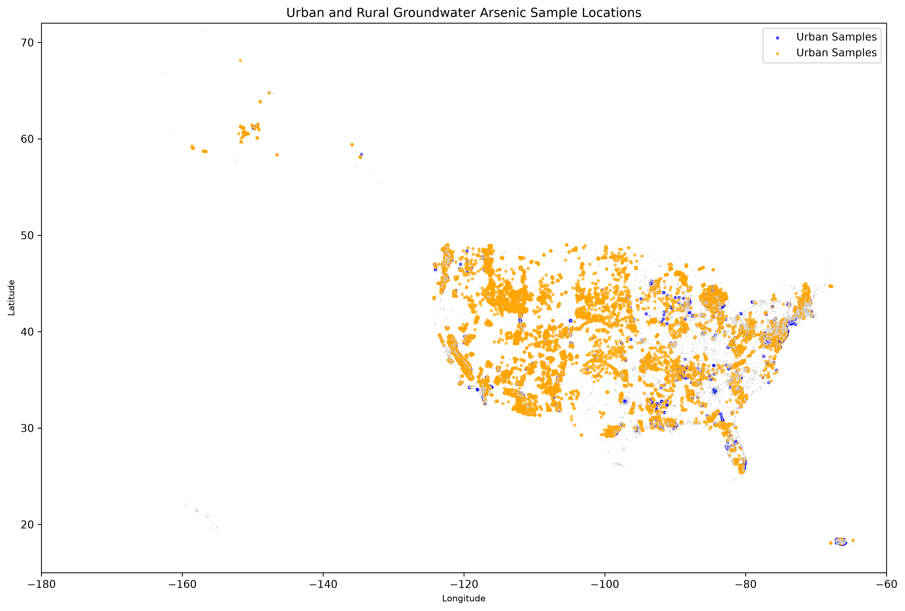
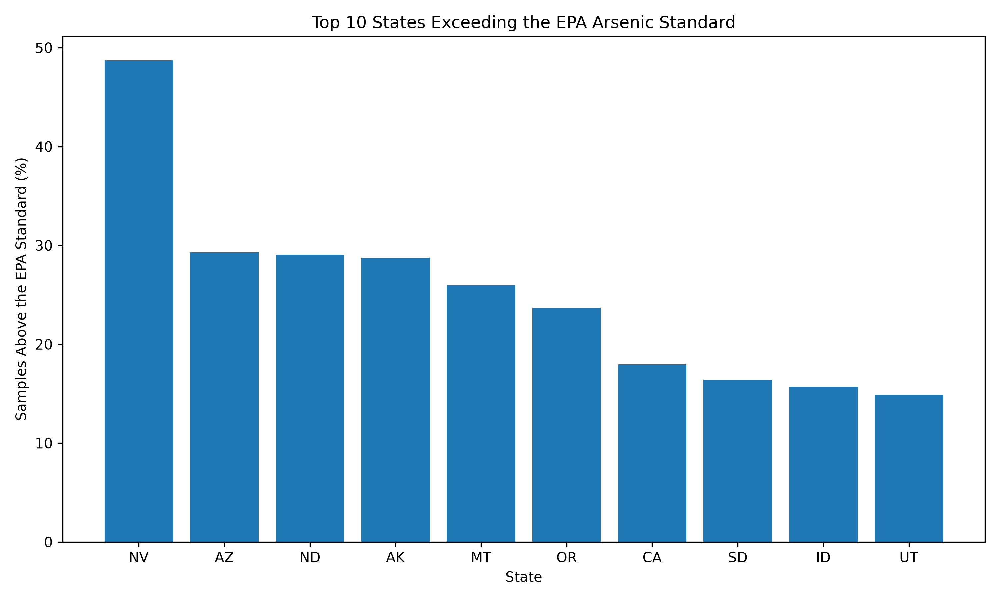

# arsenic-analysis
Analysis of the “Map of Arsenic concentrations in groundwater of the United States,” found on Data.gov catalog, with a focus on concentration trends in comparison to location or region.

### ENGR 315 Project - Arsenic Analysis

**Team Name:** The Aquifiers
**Names of Contributors:** Margot Kuennen, Jessica Neal, Helen Gikakis

### Objective and Motivation: 
The “Map of Arsenic concentrations in groundwater of the United States,” found on Data.gov catalog, provides groundwater arsenic concentration samples from several wells and springs in 49 U.S. states. The digital excel version of this dataset includes arsenic concentration, state and county identification, latitude and longitude, date, well depth, and other relevant data. This information was collected by the United States Geological Survey (USGS) and will allow us to observe regional patterns and variations. We will also compare concentrations to the Environmental Protection Agency’s (EPA) drinking water standard of 10 micrograms per liter. From this, we can form conclusions and determine which locations warrant further investigation. 

    Research Questions:
    1. How do arsenic concentrations in groundwater differ in urban and rural regions, and how do these patterns relate to population density?
        Expected Answer: numerical comparison of mean arsenic concentrations in rural versus urban areas, with a geographic distribution map for reference.  

        Potential Benefits: Observing differences in arsenic concentrations in both urban and rural areas will allow us to identify regions that require further testing. Analyzing the data will also help us recognize relationships between population density and higher arsenic concentrations. This will allow us to determine which communities have groundwater that is more vulnerable to contamination.  

    2. How do arsenic concentrations in groundwater in different states compare to the EPA’s drinking water standard? 
       Expected Answer: state comparison of arsenic concentrations and the percentage of samples that exceeds the EPA standard, with a bar graph visually demonstrating this.  

        Potential Benefits: When comparing arsenic concentrations across states, we can identify areas with a greater amount of groundwater samples exceeding the EPA drinking water standard. This will allow us to determine which states need additional monitoring.

    3. Is there a geographic connection between well-depth and arsenic concentrations? 
        Expected Answer: analysis of the relationship between well-depth and arsenic concentration using linear regression and an associated scatterplot.  

        Potential Benefits: Observing well depth and arsenic concentration will be useful when determining if having a deeper or shallower well affects the concentration level. This will allow us to identify patterns which could result in a solution that limits the number of locations that exceeds the EPA standards.  

## Introduction/Context of project: 
The goal of this project is to analyze the concentration of arsenic in groundwater in various regions across the US. In terms of context, arsenic is a highly toxic element that can disrupt cellular processes in humans. Contact with this substance can lead to many ill health effects including skin rashes and cancer. It is important to mention that the groundwater being analyzed in this project may not be the water source used by people living in that area. For example, a county with high levels of arsenic in the groundwater may be using a different water source rather than said groundwater. As of 2022, the world health organization establishes a provisional guideline of 0.01 mg/L for arsenic in groundwater, with the EPA having a standard of 10 micrograms per liter.  

## Implementation Details: 

### Question 1:

Before analyzing arsenic concentrations, groundwater samples must be classified as either urban or rural. Using the U.S. Census Bureau's 2000 urban-area boundaries, the sample locations will be sorted based on their geographic position. It is important to note that this classification has limitations, as the dataset was collected over several decades until 2001. To accomplish this, we will use the GeoPandas tool to conduct a spatial analysis of the samples and respective boundaries 

With the data samples sorted, we will then calculate metrics including mean, standard deviation, and number of samples using Pandas and NumPy. To further analyze these values, we plan to use a two-sided T-test to determine whether there is a significant difference in mean arsenic concentrations in urban versus rural areas. The t-stat and p-value will be used to determine whether to reject the null hypothesis. To make this comparison clear, a data map will be generated using Matplotlib, displaying rural and urban sample locations across the U.S. 

### Question 2:

To eventually compare state levels of arsenic concentrations in groundwater to the EPA drinking standard, the first step is to classify samples as above or below the maximum contaminant level of 10 micrograms per liter. A variable will be used to categorize the data samples as greater than or less than this value. Then, metrics will be calculated using Pandas and NumPy, including number of samples that exceed the maximum concentration, percent of samples that exceed the concentration, mean arsenic concentration, and total number of samples for each state.  

With the percent of samples that exceed the maximum contaminant level for each state, a bar chart will be generated using Matplotlib, showing the stated with the highest percentages for a visual comparison. In addition, a chi-square test will be utilized to determine if there is an association between states and their trend of arsenic levels exceeding the EPA standard.  

### Question 3:

To determine the patterns between well depth and arsenic concentrations, we will begin by organizing the data using Padas and NumPy.  The WELLDEPH column, and the AS_CONC column will be utilized. Samples with incomplete values will be excluded from the analysis and values reported below the detection limit will be considered separately.  

Using Python, we will perform linear regression. This will allow us to observe whether the arsenic concentrations increase or decrease when well depth increases.  We will generate a scatterplot which will allow us to visualize the trends. We will also separate the data into East and West regions and compare the regression results for each one.

    The following will also be added in the coming phases:
    Add any screenshot that you feel is necessary to show the project's complexity, such as block diagrams, snippets of the code that carries explicitly a method, the top-level code, etc.

## Results (Answers to the Questions): 

### Question 1: How do arsenic concentrations in groundwater differ in urban and rural regions, and how do these patterns relate to population density?
With the data samples sorted, we calculated metrics including mean, standard deviation, and number of samples using Pandas and NumPy. A two-sided T-test was used to determine whether there is a significant difference in mean arsenic concentrations in urban versus rural areas. Additionally, a plot was created for visual comparison.

 ### Overall Results

### Arsenic Concentration Statistics by Region

| Region | Sample Count | Mean (µg/L) | Median (µg/L) | Std Dev (µg/L) |
|:---|---:|---:|---:|---:|
| Rural | 15,481 | 8.18 | 1.00 | 53.80 |
| Urban | 4,562 | 4.67 | 1.00 | 18.82 |

### Two-Sided T-Test

| Metric | Result |
|:---|---:|
| T-statistic | -6.8076 |
| P-value | 1.021 × 10⁻¹¹ |
| Significance Level (α) | 0.05 |
| Decision | Reject the Null Hypothesis |

### Urban and Rural Groundwater Sample Locations

**Figure 1.** Map showing the locations of urban and rural groundwater arsenic samples. Urban samples are shown in blue, and rural samples are shown in orange.

### Interpretation
In rejecting the null hypothesis, the urban versus rural sample classifications showed a statistically significant difference in mean arsenic concentrations. 

### Data Limitations
It is important to consider several limitations within this analysis. The U.S. Census data was collected in the year 2000, while the arsenic concentrations in groundwater data was collected from 1970 - 2001. Additionally, the U.S. Census data only provided information defining urban regions, therefore areas outside of the urban boundaries were assumed to be rural. 

### Question 2: How do arsenic concentrations in groundwater in different states compare to the EPA's drinking water Standard
We used python to analyze the USGS dataset. Using Pandas, we compared the concentrations in each state to the EPA drinking water standard of 10 micrograms per liter. Wecalculated the number of samples, the number and percent that exceeds the limit, and the abverage arsenic concentration per state.
 ### Overall Results

 - **Total Groundwater Samples:** 20,043
 - **Samples Above the EPA Standard:** 2,250
 - **Percenrage abive the EPA Standard:** 11.23%

 ### State Comparison
 Nevada had the highest percentage of samples above the limit at **41.71%**, followed by Arizona at **29.31%**, and North Dakota at **29.07%**.This shows that arsenic concentrations vary between states in the dataset.

 **Figure 1: Percentage of Groundwater Samples above the EPA Drinking water Standard by State**

 ### Chi-Square Test
 A chi-square test was performed to determine whether there was an association between state and EPA exceedance status.

 - **Chi-Square Statistic:** 2203.84
 - **P-Value:** 0.00
 - **Degrees of Freedom:** 50
 - **Expected Counts Below 5:** 8

 We rejected the null hypothesis because the p-value was less than 0.05. The results suggest an association between state and arsenic exceedance status. 

 Eight expected counts were below five, so assumptions should be considered before making a final conclusion.

 ### Data Limitations
 The dataset has measurements that were below the laboratory detection limit. Saples with arsenic concentrations above the EPA standard had a "-" measurement remark.These results are understood as preliminary until tht remarks are fully understood.

### Question 3:
A linear regression was performed,followed by a scatterplot. Data was separated into East and West regions to further compare the regression results for each one.
 ### Overall Results
 Full Dataset Linear Regression:
| Metric | Result |
|:---|---:|
| Slope | -0.001445 |
| Intercept | 7.8636 |
| Correlation Coefficient (r) | -0.011867 |
| R-squared | 0.000141 |

Regional Sample Counts

| Region | Sample Count |
|:---|---:|
| West | 8,218 |
| East | 7,647 |

West Region Linear Regression

| Metric | Result |
|:---|---:|
| Slope | -0.004389 |
| Intercept | 13.106 |
| R-squared | 0.000838 |

East Region Linear Regression

| Metric | Result |
|:---|---:|
| Slope | -0.000229 |
| Intercept | 2.9496 |
| R-squared | 0.000050 |

 ### Data Limitations
159 measurements were reported below the detection limits, and therefore these samples had a "-" measurement remark. 

## Conclusions:

### Question 1:
Based on the results from Question 1, it can be concluded that there is a significant difference between the arsenic concentration levels in urban areas and rural areas. With a mean concentration of 8.18 ug/L for rural areas and a mean concentration of 4.67 ug/L in urban areas, a trend emerged from the dataset. This supports the idea that rural areas in the United States generally have higher arsenic concentrations in groundwater, however, the generated plot also highlights the difference in number of samples for urban and rural areas. 

### Question 2: 
Our Python analysis shows that arsenic concentrations vary throughout each state, Nevada had the largest percent of samples that exceeded the EPA's drinking water standard at 48.71%, Arizona had 29.31%, and North Dakota had 29.07%. The P-value was nearly 0, suggesting that there is a statistical association between state and exceedance of the EPA standard. 

### Question 3
This question was used to gather data such as, total groundwater samples which came to be 20043 with 15865 of those samples having complete well depth and concentration data. Samples reported below the detection limit were 6031 and 9834 for above or at the limit. 

**Overall Conclusion:** Our findings indicate that groundwater exceedance percentages vary accross states. 

## Actions that need to be completed:
placeholder to be populated later
List all the actions that need to be completed (a checklist). Think about this as a guide to who wants to duplicate the project.
Mention the issues that the group is facing for each action, if any.

## References/Source Files:

[1] “Map of Arsenic Concentrations in Groundwater of the United States - ScienceBase-Catalog,” www.sciencebase.gov. https://www.sciencebase.gov/catalog/item/63140561d34e36012efa2b7f (accessed Oct. 30, 2026). 

[2] U. C. Bureau, “2000 Census Urban and Rural Classification,” Census.gov. https://www.census.gov/programs-surveys/geography/guidance/geo-areas/urban-rural/2000-urban-rural.html (accessed Oct. 30, 2026). 

[3] US EPA, “Drinking Water Arsenic Rule History,” US EPA, Oct. 13, 2015. https://www.epa.gov/dwreginfo/drinking-water-arsenic-rule-history (accessed Oct. 30, 2026). 

[4] World Health Organization, “Arsenic,” World Health Organization, Dec. 07, 2022. https://www.who.int/news-room/fact-sheets/detail/arsenic (accessed Oct. 30, 2026). 
